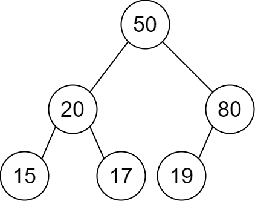
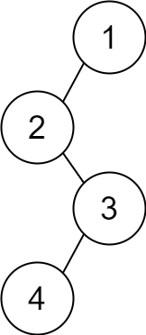

# [2196. 根据描述创建二叉树](https://leetcode.cn/problems/create-binary-tree-from-descriptions/)

给你一个二维整数数组 `descriptions` ，其中 `descriptions[i] = [parenti, childi, isLefti]` 表示 `parenti` 是 `childi` 在 **二叉树** 中的 **父节点**，二叉树中各节点的值 **互不相同** 。此外：

- 如果 `isLefti == 1` ，那么 `childi` 就是 `parenti` 的左子节点。
- 如果 `isLefti == 0` ，那么 `childi` 就是 `parenti` 的右子节点。

请你根据 `descriptions` 的描述来构造二叉树并返回其 **根节点** 。

测试用例会保证可以构造出 **有效** 的二叉树。

 

**示例 1：**



```
输入：descriptions = [[20,15,1],[20,17,0],[50,20,1],[50,80,0],[80,19,1]]
输出：[50,20,80,15,17,19]
解释：根节点是值为 50 的节点，因为它没有父节点。
结果二叉树如上图所示。
```

**示例 2：**



```
输入：descriptions = [[1,2,1],[2,3,0],[3,4,1]]
输出：[1,2,null,null,3,4]
解释：根节点是值为 1 的节点，因为它没有父节点。 
结果二叉树如上图所示。 
```

 

**提示：**

- `1 <= descriptions.length <= 104`
- `descriptions[i].length == 3`
- `1 <= parenti, childi <= 105`
- `0 <= isLefti <= 1`
- `descriptions` 所描述的二叉树是一棵有效二叉树

```python
# Definition for a binary tree node.
# class TreeNode:
#     def __init__(self, val=0, left=None, right=None):
#         self.val = val
#         self.left = left
#         self.right = right
class Solution:
    def createBinaryTree(self, descriptions: List[List[int]]) -> Optional[TreeNode]:
        nodes = {}
        children = set()
        for p,c,isLeft in descriptions:
            if p not in nodes:
                nodes[p] = TreeNode(p)
            if c not in nodes:
                nodes[c] = TreeNode(c)
            if isLeft ==1:
                nodes[p].left = nodes[c]
            else:
                nodes[p].right = nodes[c]
            children.add(c)
        for x,node in nodes.items():
            if x not in children:
                return node

```

### 1. 数据结构准备

- **`nodes` 字典**：存储 `值 → TreeNode 对象`，确保每个值只创建一个节点，避免重复。
- **`children` 集合**：记录所有在关系中作为子节点出现的值，用于后续找出谁不是任何人的子节点（即根）。

### 2. 遍历描述，建树

对每条 `[parent, child, isLeft]`：

- 若父/子节点未创建，则新建并存入 `nodes`。
- 根据 `isLeft` 的值（1 表示左孩子，0 表示右孩子）将子节点挂载到父节点的相应指针上。
- 将 `child` 加入 `children` 集合。

遍历结束时，所有节点均已生成，父子关系全部建立。

### 3. 寻找根节点

根节点的特征：**不是任何节点的孩子**，即它的值不会出现在 `children` 集合中。
遍历 `nodes`，找到第一个不在 `children` 中的节点返回即可。

### 4. 复杂度

- **时间复杂度**：O(n)，每条描述处理一次，最后的查找也只需遍历所有节点。
- **空间复杂度**：O(n)，存储所有节点和子节点集合。

### 5. 关键点

- 利用哈希表避免重复创建节点。
- 利用集合快速判断根节点。
- 无需额外建图或寻找父节点数组，简单直观。